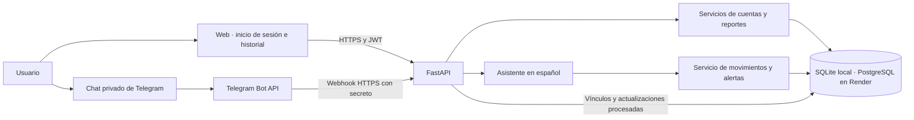
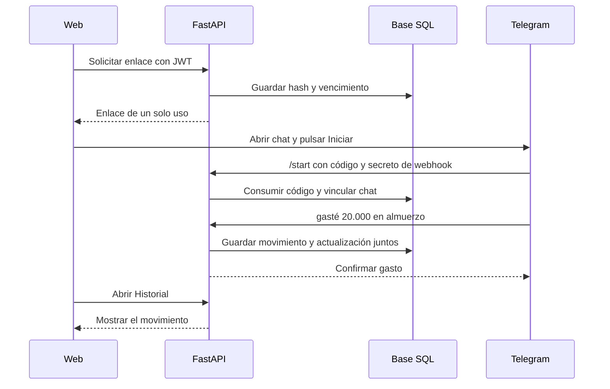

# Arquitectura

## Vinculación y registro

Cada vínculo permite un chat privado por usuario. Un identificador único de actualización impide duplicar el movimiento si Telegram reenvía el webhook. Las contraseñas conservan el almacenamiento con hash del proyecto. Las consultas web comprueban la identidad mediante JWT y filtran por propietario.
